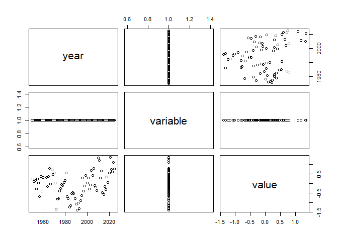

<!-- README.md is generated from README.Rmd. Please edit that file -->

# nlea: Curated Ecosystem Data for the Newfoundland and Labrador Region

#### This is an experimental R package currently in development!

`nlea` proves curated data sets to support an Ecosystem Approach to
Fisheries Management (EAFM) in Canada’s Newfoundland and Labrador
Region. It contains data sets used for ecosystem summaries and related
of oceanographic, environmental, and biological data crucial for
research stock assessment.

### Goal

The goal is to: - place all of the data used for ecosystem summaries and
related indices - create plotting functions for quick visualizations of
data - create plotting functions for use in ecosystem summaries

## Installation

You can install the development version of `nlea` from GitHub:

``` r
# install.packages("remotes")
remotes::install_github("ERL-DFO-NL/nlea")
#> Downloading GitHub repo ERL-DFO-NL/nlea@HEAD
#> 
#> ── R CMD build ─────────────────────────────────────────────────────────────────
#>          checking for file 'C:\Users\munroh\AppData\Local\Temp\1\RtmpuUl98b\remotes861c6faf5484\ERL-DFO-NL-nlea-b47b086/DESCRIPTION' ...     checking for file 'C:\Users\munroh\AppData\Local\Temp\1\RtmpuUl98b\remotes861c6faf5484\ERL-DFO-NL-nlea-b47b086/DESCRIPTION' ...   ✔  checking for file 'C:\Users\munroh\AppData\Local\Temp\1\RtmpuUl98b\remotes861c6faf5484\ERL-DFO-NL-nlea-b47b086/DESCRIPTION' (2.3s)
#>       ─  preparing 'nlea': (1.6s)
#>    checking DESCRIPTION meta-information ...     checking DESCRIPTION meta-information ...   ✔  checking DESCRIPTION meta-information
#>   Warning:     Warning: C:/Users/munroh/AppData/Local/Temp/1/Rtmp4e6ft2/Rbuild9ea016eb1349/nlea/man/fg_biomass.Rd:31: unexpected section header '\source'
#>    Warning: C:/Users/munroh/AppData/Local/Temp/1/Rtmp4e6ft2/Rbuild9ea016eb1349/nlea/man/fg_biomass.Rd:34: unexpected section header '\usage'
#>    Warning: C:/Users/munroh/AppData/Local/Temp/1/Rtmp4e6ft2/Rbuild9ea016eb1349/nlea/man/fg_biomass.Rd:43: unexpected section header '\description'
#>    Warning: C:/Users/munroh/AppData/Local/Temp/1/Rtmp4e6ft2/Rbuild9ea016eb1349/nlea/man/fg_biomass.Rd:46: unexpected section header '\details'
#>    Warning: C:/Users/munroh/AppData/Local/Temp/1/Rtmp4e6ft2/Rbuild9ea016eb1349/nlea/man/fg_biomass.Rd:49: unexpected section header '\references'
#>    Warning: C:/Users/munroh/AppData/Local/Temp/1/Rtmp4e6ft2/Rbuild9ea016eb1349/nlea/man/fg_biomass.Rd:52: unexpected section header '\author'
#>    Warning: C:/Users/munroh/AppData/Local/Temp/1/Rtmp4e6ft2/Rbuild9ea016eb1349/nlea/man/fg_biomass.Rd:55: unexpected section header '\keyword'
#>    Warning: C:/Users/munroh/AppData/Local/Temp/1/Rtmp4e6ft2/Rbuild9ea016eb1349/nlea/man/fg_biomass.Rd:56: unexpected END_OF_INPUT '
#>    '
#>       ─  checking for LF line-endings in source and make files and shell scripts (1.6s)
#>       ─  checking for empty or unneeded directories
#>   Warning:     Warning: C:/Users/munroh/AppData/Local/Temp/1/Rtmp4e6ft2/Rbuild9ea016eb1349/nlea/man/fg_biomass.Rd:31: unexpected section header '\source'
#>    Warning: C:/Users/munroh/AppData/Local/Temp/1/Rtmp4e6ft2/Rbuild9ea016eb1349/nlea/man/fg_biomass.Rd:34: unexpected section header '\usage'
#>    Warning: C:/Users/munroh/AppData/Local/Temp/1/Rtmp4e6ft2/Rbuild9ea016eb1349/nlea/man/fg_biomass.Rd:43: unexpected section header '\description'
#>    Warning: C:/Users/munroh/AppData/Local/Temp/1/Rtmp4e6ft2/Rbuild9ea016eb1349/nlea/man/fg_biomass.Rd:46: unexpected section header '\details'
#>    Warning: C:/Users/munroh/AppData/Local/Temp/1/Rtmp4e6ft2/Rbuild9ea016eb1349/nlea/man/fg_biomass.Rd:49: unexpected section header '\references'
#>    Warning: C:/Users/munroh/AppData/Local/Temp/1/Rtmp4e6ft2/Rbuild9ea016eb1349/nlea/man/fg_biomass.Rd:52: unexpected section header '\author'
#>    Warning: C:/Users/munroh/AppData/Local/Temp/1/Rtmp4e6ft2/Rbuild9ea016eb1349/nlea/man/fg_biomass.Rd:55: unexpected section header '\keyword'
#>    Warning: C:/Users/munroh/AppData/Local/Temp/1/Rtmp4e6ft2/Rbuild9ea016eb1349/nlea/man/fg_biomass.Rd:56: unexpected END_OF_INPUT '
#>    '
#>       ─  building 'nlea_0.0.0.9000.tar.gz' (549ms)
#>      
#> 
#> Installing package into 'C:/Users/munroh/AppData/Local/R/win-library/4.6'
#> (as 'lib' is unspecified)
```

## Quick Start

This is currently under development but here is what we have so far.

``` r
library(nlea)
library(ggplot2) #for customization
#> Warning: package 'ggplot2' was built under R version 4.6.2

# 1. Load data (e.g. Newfoundland Climate Index)
data("nlci")

# 2. Look at data
head(nlci)
#> # A tibble: 6 × 3
#>    year variable value
#>   <dbl> <chr>    <dbl>
#> 1  1950 nlci     NA   
#> 2  1951 nlci      0.22
#> 3  1952 nlci      0.1 
#> 4  1953 nlci      0.16
#> 5  1954 nlci     -0.3 
#> 6  1955 nlci      0.23

# 3. Quick plot
plot(nlci)
```



## Available Data (development)

> List of where we are going

| Dataset | Description | Source |
|----|----|----|
| nlci | Aggregated NL Climate Index (NLCI) | [Cyr and Galbrath et al 2021](https://doi.org/10.20383/103.01670) |
| nlci_sub | Natural sign NLCI subindices | [Cyr and Galbrath et al 2021](https://doi.org/10.20383/103.01670) |
| fg_abundance | Abundance from RV survey of functional groups | EcoSum Resdoc |
| fg_biomass | Biomass from RV survey of functional groups | EcoSum Resdoc |
| fg_biomass_abundance_ratio | Biomass-Abundance ratio from RV survey of functional groups | EcoSum Resdoc |
| fg_scaled_biomass | Scaled biomass from RV survey of functional groups | EcoSum Resdoc |
| TBA | Zooplankton indices | AZMP regional tech report |
| TBA | Species biomass | EcoSum Resdoc |
| TBA | Biomass density by EPU | EcoSum Resdoc |
| TBA | Diets of key predators | EcoSum Resdoc |
| TBA | Stomach weights | EcoSum Resdoc |
| TBA | TCI vs catch ratio | NAFO SAR |
| TBA | landings by functional guilds | NAFO SAR |
| TBA | Fishing Effort | Open data/Res doc |

> This is the issue of spatial data and how we will deal with that

- Fishing effort layers
- Bottom temperature (CABOTS)
